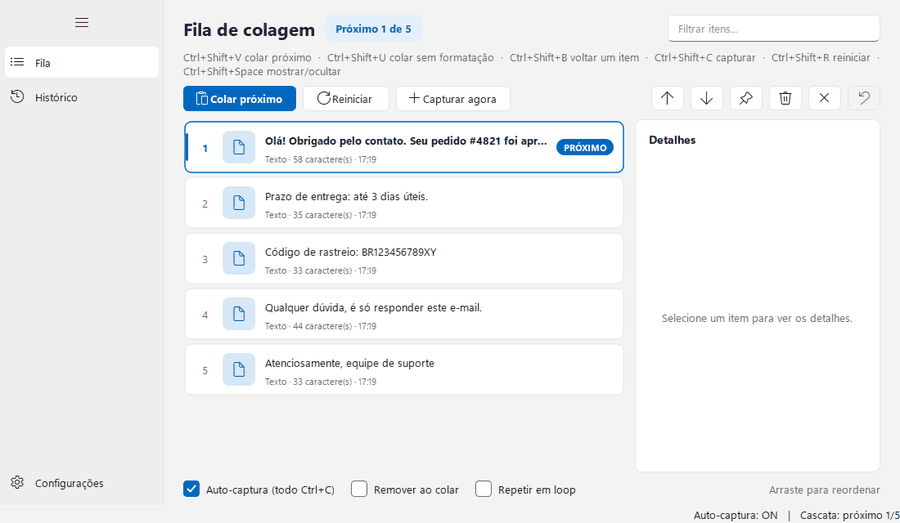
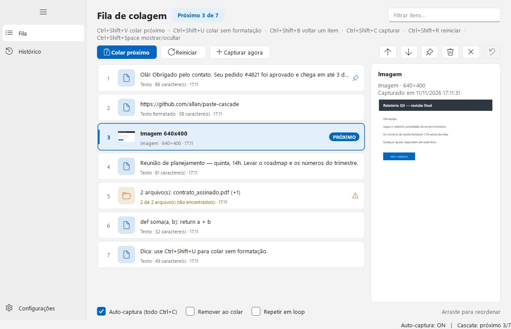
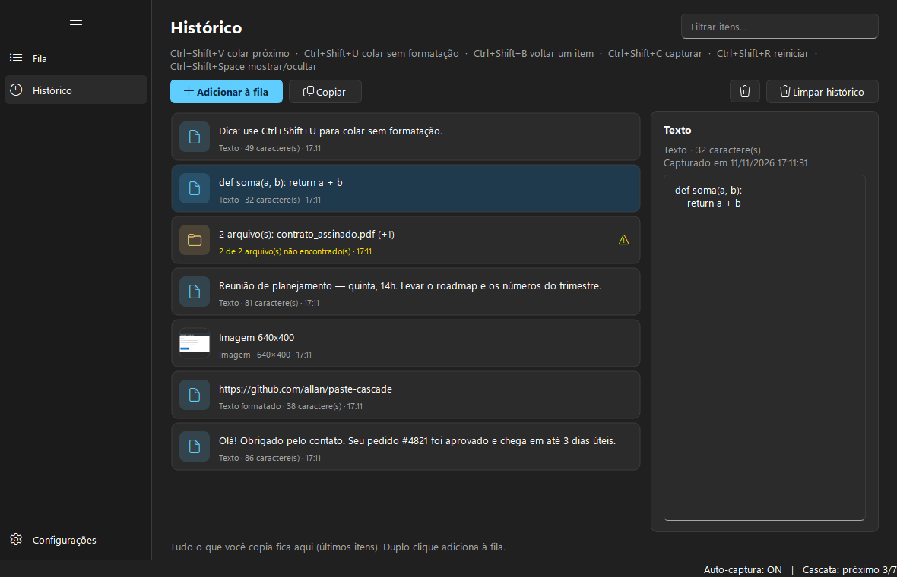
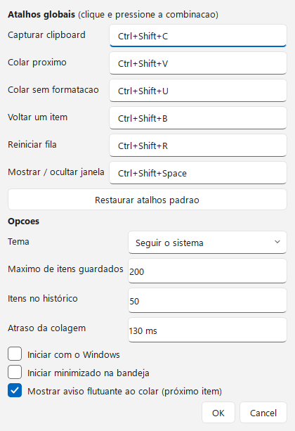

<p align="center">
  
</p>

<h1 align="center">Paste Cascade</h1>

<p align="center">
  Copie vários itens, depois cole um por um, na ordem.<br>
  Um organizador de <b>copiar e colar em cascata</b> para Windows.
</p>

<p align="center">
  
  
  
  
</p>

---

<!-- Gravar um GIF de ~15 s (copiar 4 itens e colar em sequência) e salvar em docs/demo.gif -->
<p align="center">
  
</p>

## Por que existe

Você precisa colar cinco trechos em cinco lugares diferentes. Com o `Ctrl+C` e o `Ctrl+V`
comuns, isso vira um vai-e-volta de janelas. O **Paste Cascade** guarda tudo o que você copia
numa fila e cola um item por vez, com um atalho, no programa que estiver em foco.



## Recursos

- **Fila em cascata:** cada `Ctrl+Shift+V` cola o próximo item e avança o cursor.
- **Texto, imagens e arquivos:** tudo entra na mesma fila.
- **Formatação preservada:** texto copiado do Word ou do navegador mantém o formato ao colar.
  Use `Ctrl+Shift+U` para colar sem formatação.
- **Histórico:** tudo o que você copia fica registrado. Adicione de volta à fila com um duplo clique.
- **Fixar, desfazer e editar:** itens fixados sobrevivem a "Limpar"; `Ctrl+Z` desfaz remoções;
  textos podem ser editados pelo menu de contexto.
- **Aviso flutuante:** ao colar, um aviso discreto mostra o item colado e o próximo, sem abrir a janela.
- **Visual Windows 11:** menu lateral, cards, painel de detalhes e tema **claro, escuro ou do sistema**.
- **Tudo local:** nada sai do seu computador. Sem telemetria, sem conta, sem internet.

<p align="center">
  
  
</p>

## Instalação

### Opção 1: baixar o executável (recomendado)

1. Vá em **[Releases](../../releases)** e baixe `PasteCascade.exe`.
2. Clique duas vezes para abrir. Não precisa instalar Python.

> Na primeira execução o Windows pode mostrar o aviso *"O Windows protegeu o computador"*
> (SmartScreen), porque o executável não é assinado digitalmente. Clique em **Mais informações →
> Executar assim mesmo**. O código-fonte está todo aqui para você conferir.

### Opção 2: rodar a partir do código

Requer **Python 3.10 ou superior**.

```powershell
git clone https://github.com/DesapuroJoseph/paste-cascade.git
cd paste-cascade
py -m pip install -r requirements.txt
py -m paste_cascade            # com terminal, útil para ver erros
pythonw run.pyw                # sem terminal
```

## Como usar

| Ação | Atalho | O que faz |
|------|--------|-----------|
| Colar próximo | `Ctrl+Shift+V` | Cola o próximo item no programa em foco e avança |
| Colar sem formatação | `Ctrl+Shift+U` | Igual ao anterior, mas só texto puro |
| Voltar um item | `Ctrl+Shift+B` | Recua o cursor (útil depois de um pulo sem querer) |
| Capturar agora | `Ctrl+Shift+C` | Adiciona o conteúdo atual do clipboard à fila |
| Reiniciar a fila | `Ctrl+Shift+R` | Volta o cursor para o primeiro item |
| Mostrar / ocultar | `Ctrl+Shift+Space` | Abre ou esconde a janela |

**Passo a passo:**

1. Copie o texto 1 (`Ctrl+C`), depois o texto 2, o 3 e assim por diante. Cada cópia entra na fila.
2. Vá para o programa de destino e pressione `Ctrl+Shift+V` a cada colagem.
3. Os atalhos são globais e podem ser trocados em **⚙ Configurações**.

**Dicas:**
- Arraste os itens para reordenar. Duplo clique define por onde a cascata começa.
- Botão direito abre mais ações: copiar, editar, fixar, duplicar, mover.
- **Auto-captura** (ligada por padrão) registra todo `Ctrl+C`. Desligue se preferir escolher o que entra com `Ctrl+Shift+C`.
- **Remover ao colar** consome o item depois de colá-lo. Com a opção desligada, o item continua na fila.

## Onde ficam seus dados

Tudo fica em `%APPDATA%\PasteCascade\`:

- `items.json`: a fila
- `history.json`: o histórico
- `settings.json`: preferências
- `blobs\`: imagens copiadas (PNG)

Apague a pasta para zerar tudo. Nada é enviado para fora do computador.

## Gerar o executável

```powershell
powershell -ExecutionPolicy Bypass -File build_exe.ps1
```

Gera `dist\PasteCascade.exe` (arquivo único, sem janela de console), usando o PyInstaller.
O ícone também é regenerado a partir do código em `paste_cascade/icon.py`.

## Testes

```powershell
py -m unittest discover -s tests -v
```

Os testes rodam sem janela (Qt em modo `offscreen`) e com um `%APPDATA%` temporário, sem tocar nos seus dados.

## Estrutura do projeto

```
paste_cascade/
  app.py            inicialização, instância única, fiação dos módulos
  engine.py         captura, colagem em cascata e ações do cursor
  store.py          fila, histórico, lixeira (desfazer) e persistência
  clipboard_io.py   leitura e escrita do clipboard do Windows
  win_hotkeys.py    atalhos globais (RegisterHotKey)
  win_input.py      injeção de Ctrl+V (SendInput)
  main_window.py    janela principal
  settings_dialog.py  configurações
  theme.py          tema Windows 11 (claro / escuro / sistema)
  hud.py            aviso flutuante ao colar
  tray.py           ícone na bandeja
  autostart.py      iniciar com o Windows
  icon.py           ícone vetorial (usado no app e no .exe)
tests/              testes unitários e smoke test da janela
```

## Roadmap

- [ ] Opção para colar sempre como texto puro (hoje o padrão mantém a formatação)
- [ ] Instalador (MSIX) e assinatura digital do executável
- [ ] Suporte a outros idiomas (inglês)
- [ ] Atalhos por item (colar o item 3 diretamente)

Tem uma ideia? Abra uma [issue](../../issues).

## Contribuir

Contribuições são bem-vindas. Antes de abrir um Pull Request, rode os testes e mantenha o estilo do código existente.

## Licença

Distribuído sob a licença **MIT**. Veja [LICENSE](LICENSE).
